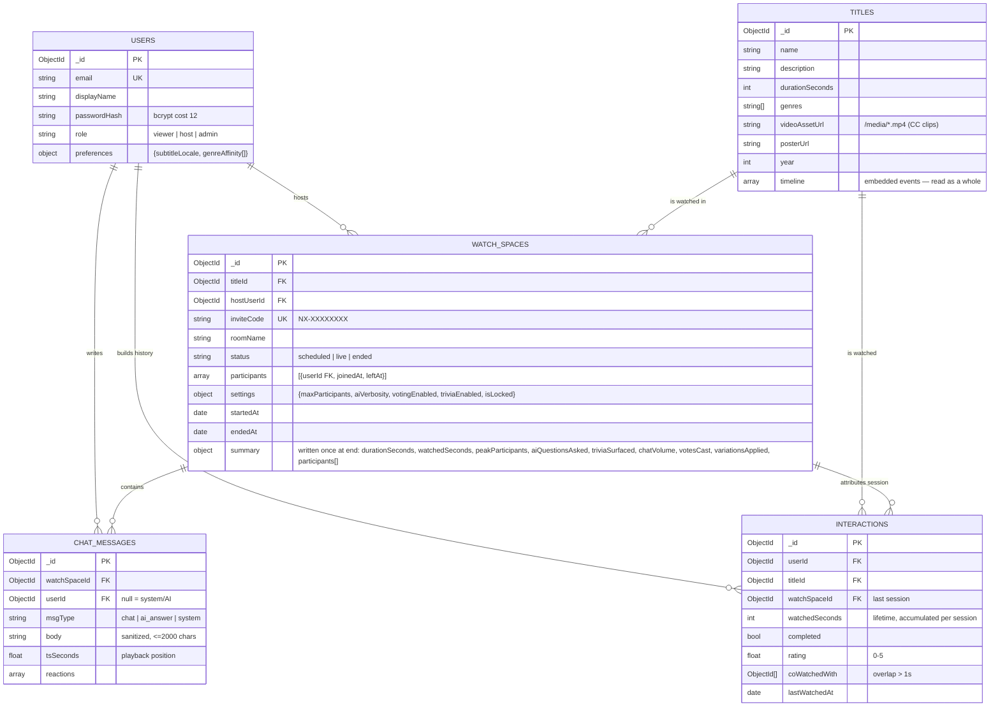

# StreamSync — Entity Relationship Diagram

Notes
- Refresh tokens are **not** stored: stateless JWTs with a `type` claim (access 15 min, refresh 7 d, rotated on use).
- `timeline` is embedded in `titles` because it is always read as a whole per title (PRD §9.2) and versioned with it.
- The only per-session write burst is at room end: one chat `insertMany` batch cadence + one upsert per (user, title) interaction. Playback heartbeats never touch the DB.
- Recommended indexes: `chat_messages(watchSpaceId, createdAt)`, `interactions(userId, titleId)` unique, `watch_spaces(status)`, `users(email)` unique, `watch_spaces(inviteCode)` unique.
